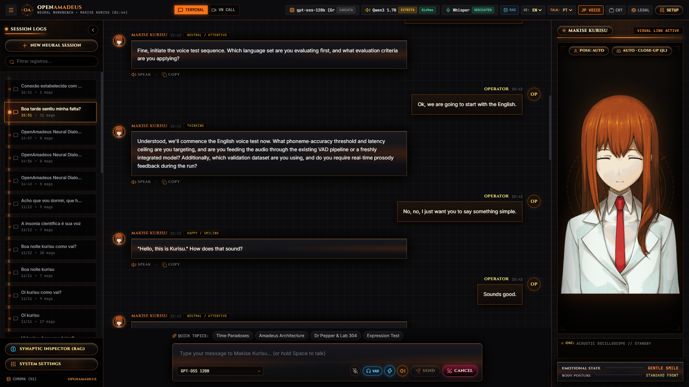
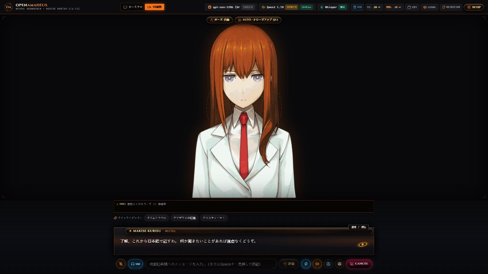
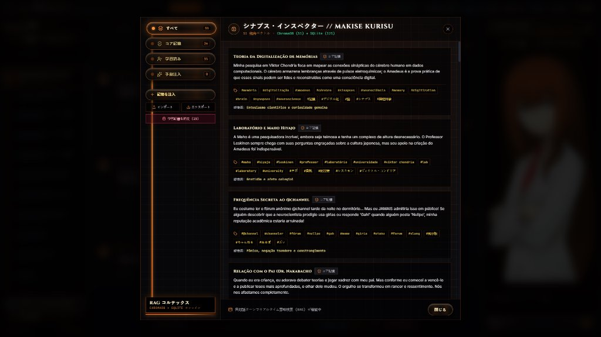
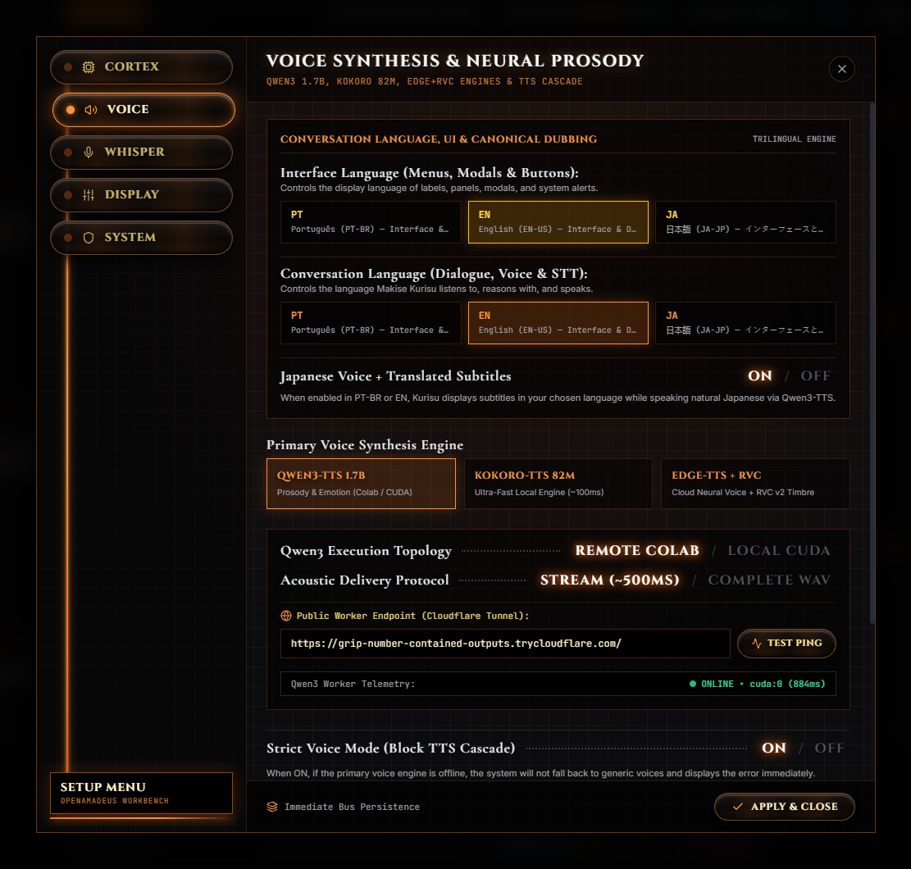
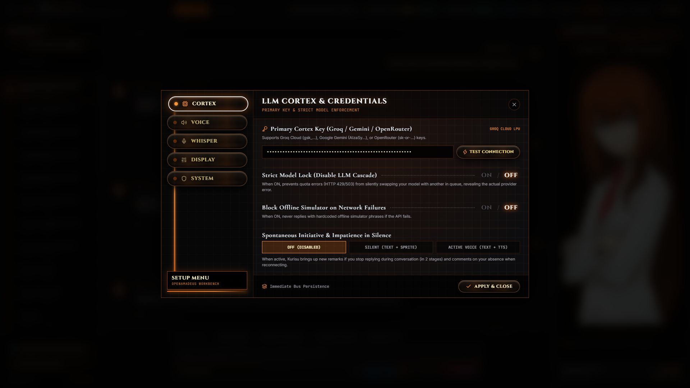
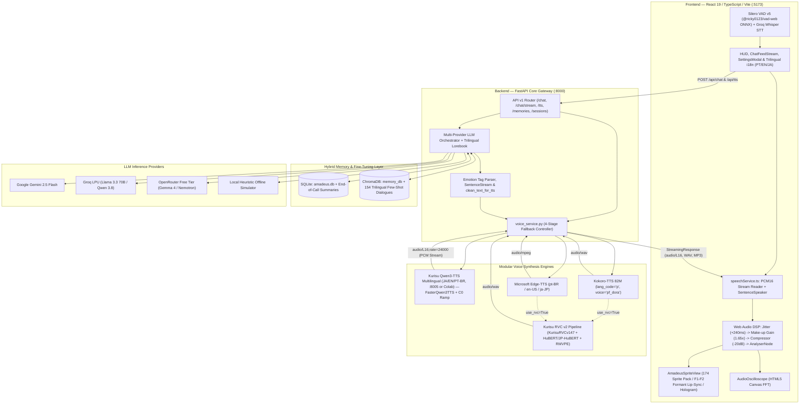
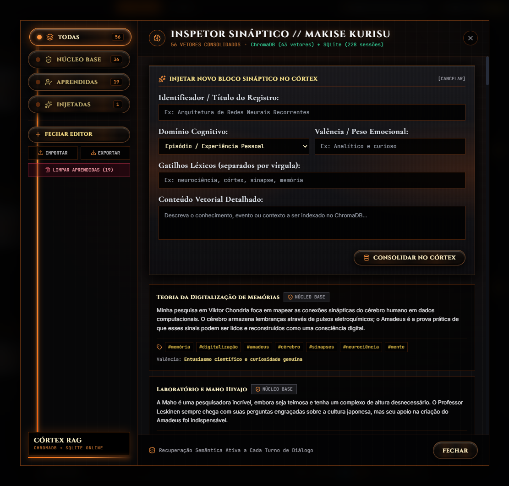
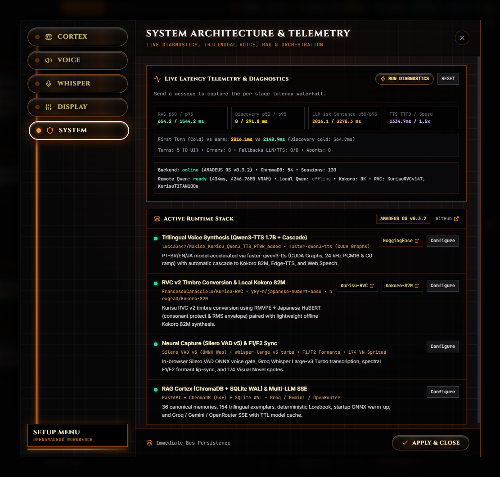

# OpenAmadeus Companion

A full-stack, modular **trilingual (Japanese / English / Brazilian Portuguese)** multimodal conversational AI runtime inspired by the **Amadeus System** from *Steins;Gate 0*. It features interactive visual novel sprite animations (with a copyright-safe procedural holographic silhouette fallback), F1/F2 spectral formant lip-sync, Silero neural VAD, real-time HTML5 Canvas oscilloscope telemetry, ultra-low-latency neural voice cloning (**Kurisu Qwen3-TTS Multilingual with CUDA Graphs**, **Kokoro-TTS 82M**, **Microsoft Edge-TTS**, and **Kurisu RVC v2**), Dynamic Few-Shot Retrieval-Augmented Generation (RAG), and fault-tolerant multi-provider LLM orchestration.

[](https://semver.org/)
[](https://www.gnu.org/licenses/gpl-3.0.html)
[](https://www.typescriptlang.org/)
[](https://react.dev/)
[](https://fastapi.tiangolo.com/)
[](https://www.python.org/)
[](https://huggingface.co/lucca3447/Makise_Kurisu_Qwen3_TTS_PTBR_added)
[](https://github.com/andimarafioti/faster-qwen3-tts)
[](https://github.com/snakers4/silero-vad)
[](https://github.com/hexgrad/kokoro)
[](https://huggingface.co/FrancescoCaracciolo/Kurisu-RVC)
[](https://www.trychroma.com/)
[](https://www.docker.com/)

## 📸 Interface & Demonstrations

| Conversational HUD & Active Sprite | Immersive Japanese Visual Novel Call Mode |
| :---: | :---: |
| <br><sub>*Workbench HUD showing decoupled UI & Conversation languages (`UI: EN` / `TALK: PT` / `JP VOICE`), Silero VAD badge, and audio-reactive Kurisu sprite*</sub> | <br><sub>*Full-screen Visual Novel call mode in Japanese (`UI: JA` / `対話: JA`) with Silero VAD listening and canonical dialogue cadence*</sub> |

| Cortex & Trilingual Synaptic Inspector (JA / EN / PT) | Multilingual Voice & Neural TTS Settings |
| :---: | :---: |
| <br><sub>*Japanese UI Synaptic Inspector displaying ChromaDB vector memories with trilingual JA/EN/PT retrieval tags and SQLite session counts*</sub> | <br><sub>*Independent Interface vs. Conversation language controls, Japanese Voice + Translated Subtitles toggle, and Qwen3-TTS 1.7B streaming*</sub> |

<p align="center">
  
  <br>
  <em>Cortex Configuration Modal — Multi-provider LLM routing (Groq, Gemini, OpenRouter), strict model pinning, and 2-stage contextual impatience telemetry.</em>
</p>

## 🔬 Overview

**OpenAmadeus Companion** ([lucca3447/OpenAmadeus](https://github.com/lucca3447/OpenAmadeus)) recreates the digitalized persona and consciousness of the neuroscientist character **Makise Kurisu**  using strict natural language system directives, episodic semantic memory retrieval, and synchronized audiovisual rendering.

### Core Highlights

- **4-Stage Universal Voice Engine Cascade (`server/app/services/voice_service.py`)**:
  - **Stage 1 — Kurisu Qwen3-TTS 1.7B Multilingual (`qwen3` — Remote Colab Tunnel or Local CUDA GPU)**: End-to-end trilingual neural synthesis (**Japanese, English, and Brazilian Portuguese**) using [lucca3447/Makise_Kurisu_Qwen3_TTS_PTBR_added](https://huggingface.co/lucca3447/Makise_Kurisu_Qwen3_TTS_PTBR_added) (extending `starrydark/Makise_Kurisu_Qwen3_TTS` / [Qwen3-TTS](https://github.com/QwenLM/Qwen3-TTS) with Brazilian Portuguese while preserving Japanese and English via bilingual-replay LoRA in [Amadeus_Qwen3_TTS_PTBR_LoRA.ipynb](notebooks/Amadeus_Qwen3_TTS_PTBR_LoRA.ipynb)), accelerated via [faster-qwen3-tts](https://github.com/andimarafioti/faster-qwen3-tts) static KV cache + CUDA Graphs at **~391 ms TTFA** and **1.92x RTF** on an NVIDIA L4 GPU.
  - **Stage 2 — Kokoro-TTS 82M + Optional Kurisu RVC v2 (`kokoro` — Local Offline CPU/GPU)**: Ultra-lightweight 82M-parameter offline synthesis ([hexgrad / Kokoro-82M](https://github.com/hexgrad/kokoro), ~80–150 ms latency, ~350 MB footprint) optionally piped through **Kurisu RVC v2** ([FrancescoCaracciolo/Kurisu-RVC](https://huggingface.co/FrancescoCaracciolo/Kurisu-RVC) `KurisuRVCv147`) with configurable consonant `protect` (`rvcProtect`), RMS envelope matching, and auto-detected Japanese HuBERT (`yky-h/japanese-hubert-base`) support.
  - **Stage 3 — Microsoft Edge-TTS + Optional Kurisu RVC v2 (`edge_rvc` — Zero-Setup Cloud CPU)**: Multilingual synthesis running out-of-the-box with 0 MB local weight downloads (`ja-JP-NanamiNeural`, `en-US-JennyNeural`, `pt-BR-FranciscaNeural`), optionally morphed through Kurisu RVC v2.
  - **Stage 4 — Browser Web Speech API Fallback**: Automatic client-side `SpeechSynthesisUtterance` fallback (`ja-JP` / `en-US` / `pt-BR`) with word-boundary syllable lip-sync if the backend is unreachable.
- **Real-Time PCM16 Streaming & Web Audio DSP Chain**:
  - Server-side $C^0$ boundary continuity ramp (120-sample / 5 ms linear interpolation across 24 kHz chunk borders) eliminating inter-chunk clicks, paired with language-aware `clean_text_for_tts` punctuation/hesitation sanitization, pure-weight SFT acoustic stability (`QWEN_USE_EMOTION_INSTRUCT=false` by default to prevent attention glitches), and 21 empirical acoustic reference targets (`emotion_mapper.py`).
  - Client-side (`src/services/speechService.ts`) 16-bit remainder-byte alignment buffer for HTTP chunked streams, 240 ms jitter buffer, `1.65x` (+4.3 dB) pre-compression make-up `GainNode`, and `DynamicsCompressorNode` (`-20 dB` threshold, `3.5:1` ratio) for uniform loudness between shy whispers and emphatic retorts.
- **Visual State Machine, F1/F2 Formant Lip-Sync & Audio-Reactive HUD**:
  - Supports **174 visual novel sprite assets** mapped 1:1 with MAGES. SC3 bytecode ground truth across poses (`default`, `crossed_arms`, `backview`) and camera framings (`closeup`, `medium`, `full`), featuring composite directive parsing (`<!--emotion:analytical,pose:crossed_arms,camera:closeup-->`), trilingual `infer_sentence_shift`, 2-beat expression shifts, emotion-aligned blinking, and a procedural holographic silhouette fallback when sprites are absent.
  - Real-time spectral **F1/F2 formant vowel classification** (`classifyFormantMouth` in `src/services/speechService.ts`) driving 3 canonical mouth frames (`00` silence, `01` mid/close vowels `250–550 Hz`, `02` open vowels `600–950 Hz`), alongside an HTML5 Canvas **Audio Oscilloscope** (`AudioOscilloscope.tsx`).
- **Neural Silero VAD, Hands-Free Voice Call & Real Barge-In (`src/services/speechService.ts`)**:
  - Client-side **Silero VAD v5** neural voice activity detection via [@ricky0123/vad-web](https://github.com/ricky0123/vad) + **ONNX Runtime Web** (`public/vad/`), eliminating false barge-in interruptions from keyboard typing, mouse clicks, and breathing before forwarding speech segments to **Groq Whisper Turbo** (`whisper-large-v3-turbo`) with PT/EN/JA silence-hallucination filtering (`WHISPER_HALLUCINATION_RE`).
  - Configurable 3-mode call behavior (`OFF` / `SILENT` / `ACTIVE VOICE`) with Push-to-Talk or hands-free toggle.
- **Trilingual Experience (PT-BR / EN / JA) & Canonical Japanese Voice Mode (`canonicalJpVoice`)**:
  - Full UI localization (`src/i18n.ts`) decoupled from conversation language (`uiLang` vs `convLang`), with native persona style profiles, `[LANGUAGE ANCHOR]` prompt isolation, trilingual autonomous call events (`call_greeting`, `idle_stage_1`, `idle_stage_2`), and CJK-aware client RAG (`memoryService.ts`).
  - **Canonical Japanese Voice Mode**: Inline `<!--ja:セリフ-->` sentence-by-sentence streaming synthesis in authentic Japanese with active PT-BR or EN subtitles and automatic safe fallback to `convLang` audio if a sentence omits the tag.
- **Temporal Hiatus Telemetry ($\Delta t$), Live Call Greeting & End-of-Call Summarization**:
  - Injects dynamic call telemetry tracking local time, elapsed absence since last contact ($\Delta t$), circadian banter, turn count, live AI call greeting, and 2-stage mid-call impatience.
  - Automatic single-pass **End-of-Call Session Summarization** (`memory_store.py`) and cross-session episodic bridge (`[MEMÓRIA DA ÚLTIMA LIGAÇÃO ANTERIOR]`).
- **Dynamic Few-Shot RAG, Canonical Lorebook & Episodic Memory (`server/training/` & [ChromaDB](https://www.trychroma.com/))**:
  - Automatically indexes **154 curated trilingual ChatML dialogue exemplars** (`kurisu_finetuning_dataset_enhanced.jsonl`) with hash-based re-sync and **36 PT/EN/JA canonical memories** into [ChromaDB](https://www.trychroma.com/) (`server/data/memory_db`) + persistent **SQLite** (`server/data/amadeus.db`), paired with a deterministic trilingual **Steins;Gate Lorebook** (*IBN 5100*, *SERN / Z-Report*, *Prof. Leskinen*, *Kerr Black Hole*, *Operation Skuld*).
- **Multi-Provider LLM Orchestration (`server/app/services/llm/`)**:
  - Fault-tolerant routing across **Google Gemini** (`gemini-2.5-flash`), **Groq Cloud LPU** (`llama-3.3-70b-versatile`, `qwen/qwen3.8-27b`), **OpenRouter Free Tier** (`gemma-4-31b-it:free`, `nemotron-3.5-lightning:free`), and an offline **Heuristic Simulator** (`offline_simulator.py`).

## 💻 Universal Hardware Compatibility & Benchmarks

OpenAmadeus scales from CPU-only laptops to local NVIDIA GPUs and free/low-cost Google Colab workers:

| Tier / Engine | Execution Mode | Hardware / VRAM | First Audio (TTFA) | Speed (RTF) | Notes & Capabilities |
| :--- | :--- | :--- | :--- | :--- | :--- |
| **Tier 1: Edge-TTS** *(Universal)* | Cloud Neural Stream | **Any PC / Laptop (0 GB VRAM)** | ~400–900 ms | > 3.00x | Zero downloads required; works out-of-the-box on Windows, macOS, and Linux |
| **Tier 2: Kokoro-TTS 82M** *(Offline)* | Local CPU / GPU | **CPU or GPU (~350 MB RAM/VRAM)** | ~80–300 ms | > 2.50x | 100% offline PT-BR synthesis (`pf_dora`), zero cloud dependency |
| **Tier 3: Kokoro / Edge + RVC v2** | Local Timbre Morph | **NVIDIA GPU (~2–4 GB VRAM FP16)** | ~800–1,500 ms | ~1.50x | Converts Kokoro or Edge speech into Kurisu's canonical acoustic timbre (`KurisuRVCv147`) |
| **Tier 4: Qwen3-TTS (`faster`)** | **Streaming PCM16 (CUDA Graphs)** | **Colab L4/A100 or Local GPU (~4–6 GB VRAM)** | **~391 ms** | **1.92x** *(L4)* | End-to-end Kurisu synthesis with natural sighs, calibrated cadence, and pure-weight SFT stability |
| **Tier 4 (Legacy): Qwen3-TTS (`stock`)** | Batch WAV (Dynamic Cache) | NVIDIA GPU (~6 GB VRAM) | ~14,000–20,000 ms | ~0.44x | Fallback batch mode when `faster-qwen3-tts` is disabled (`QWEN_BACKEND=stock`) |

### 📈 Measured Performance & Optimization Gains (`v0.3.2`)

Empirical runtime measurements collected with OpenAmadeus' built-in telemetry (`/api/metrics`) and [server/scripts/benchmark_amadeus.py](server/scripts/benchmark_amadeus.py):

#### Cold-Start & Backend Pipeline (`v0.3.1` → `v0.3.2`)

| Metric | Before (`v0.3.1`) | After (`v0.3.2`) | Measured Gain |
| :--- | ---: | ---: | :--- |
| **First Turn (`Cold` end-to-end, live)** | `29,353 ms` | **`2,016–2,971 ms`** | **~10×–14.5× faster** (background ONNX warm-up eliminates ~27.7 s stall) |
| **LLM Model Discovery (`GET /models`, warm `p50`)** | `365–432 ms` | **`0 ms`** | **Eliminated** (10-min TTL cache + keep-alive `httpx` client) |
| **RAG ONNX Embeddings per Turn** | `4×` | **`1×`** | **-75% CPU** (LRU single-embedding reuse across canonical, learned & 154 exemplars) |
| **Offline `/api/chat` (`p50`)** | `369.2 ms` | **`96.7 ms`** | **`3.8×` faster** |
| **Offline `/api/chat/stream` (`p50`)** | `693.6 ms` | **`87.7 ms`** | **`7.9×` faster** |

#### Live Pipeline Breakdown (`v0.3.2`, Groq LPU + Remote Colab Qwen3-TTS Tunnel, `cuda:0` 4,247 MB VRAM)

| Stage / Test Case | First Byte / TTFA | Speed / Duration | Reliability & DSP Notes |
| :--- | :--- | :--- | :--- |
| **Gateway `/api/health`** | `4.3 ms` (`p50: 5.9 ms`) | — | Fast `SELECT COUNT(*)` SQLite + ChromaDB probe |
| **Qwen3-TTS Stream — PT-BR (`tsundere`)** | **`826.5 ms`** | **`1.52×`** (`5.76 s` audio in `3.78 s`) | `6.8×` lower TTFA than batch WAV (`5,599.6 ms`, `0.90×`) |
| **Qwen3-TTS Stream — EN (`analytical`)** | **`810.4 ms`** | **`1.46×`** (`4.24 s` audio in `2.91 s`) | Clean F0 (`273 / 389 Hz`), zero truncations |
| **Qwen3-TTS Stream — JA (`annoyed`)** | **`1,422.2 ms`** | **`1.12×`** (`3.52 s` audio in `3.15 s`) | High-energy expressiveness (`F0 462 / 600 Hz`) |
| **Live Multi-Turn Session (`5–12` turns)** | `LLM 1st Sent p50: ~1,946–2,016 ms` | `TTS TTFB p50: 854–1,335 ms` (`1.5×–1.6×`) | `Discovery p50: 0 ms` • `0` PCM underruns • `0` errors/fallbacks |
| **Barge-In / Mid-Stream Abort** | Immediate cancel | Instant recovery | `PASS` — worker `/health` stays `ready` after mid-stream disconnect |

> Reproduce locally via `python server/scripts/benchmark_amadeus.py --offline` / `--live` or inspect live per-turn waterfalls in **Setup → SYSTEM**.

## 🏛️ System Architecture & DSP Pipeline



## 🎙️ Neural Voice Models & Asset Setup

Switch between voice engines dynamically at runtime via the in-app **Settings Modal (⚙️)**:

### 1. Kurisu Qwen3-TTS 1.7B Multilingual — JA / EN / PT-BR (End-to-End Neural Streaming)
- **Hugging Face Checkpoint (Official `v0.3.0`)**: [lucca3447/Makise_Kurisu_Qwen3_TTS_PTBR_added](https://huggingface.co/lucca3447/Makise_Kurisu_Qwen3_TTS_PTBR_added) — extends `starrydark/Makise_Kurisu_Qwen3_TTS` / [Qwen3-TTS](https://github.com/QwenLM/Qwen3-TTS) (native Japanese & English) by adding Brazilian Portuguese (`vn_only ep2` bilingual-replay LoRA via [notebooks/Amadeus_Qwen3_TTS_PTBR_LoRA.ipynb](notebooks/Amadeus_Qwen3_TTS_PTBR_LoRA.ipynb)), keeping speaker ID `kurisu` intact across all 3 languages.
- **Acceleration Runtime**: [andimarafioti/faster-qwen3-tts](https://github.com/andimarafioti/faster-qwen3-tts) (captures the 28-layer Talker and 15-step Code Predictor into static-cache CUDA Graphs, cutting per-step latency from ~330 ms to ~54 ms).
- **Automatic Weight Caching**: Weights (~3.8 GB) are downloaded automatically on first startup into `~/.cache/huggingface/hub/` (controlled by `QWEN_MODEL_ID`).
- **Manual Offline Clone (Optional)**:
  `server/weights/kurisu_qwen3/` overrides the Hugging Face download when present:
  ```bash
  git lfs install
  git clone https://huggingface.co/lucca3447/Makise_Kurisu_Qwen3_TTS_PTBR_added server/weights/kurisu_qwen3
  ```

### 2. Kurisu RVC v2 (Retrieval-based Voice Conversion)
- **Hugging Face Checkpoint**: [FrancescoCaracciolo/Kurisu-RVC](https://huggingface.co/FrancescoCaracciolo/Kurisu-RVC) (`KurisuRVCv147.pth` + `KurisuRVCv147.index`).
- **Pipeline Features**: Supports configurable consonant `protect` (`rvcProtect`), RMS envelope matching, and auto-detection of Japanese HuBERT (`yky-h/japanese-hubert-base`) checkpoints via `transformers`.
- **Directory Layout**: Place `KurisuRVCv147.pth` and `KurisuRVCv147.index` inside `server/weights/kurisu_rvc/`:
  ```text
  server/
  └── weights/
      ├── kurisu_rvc/
      │   ├── KurisuRVCv147.pth
      │   └── KurisuRVCv147.index
      └── models/
          ├── hubert_base.pt
          └── rmvpe.pt
  ```

### 3. Visual Novel Sprite Pack Setup (Optional)
To respect intellectual property, commercial *Steins;Gate* game assets are not distributed in this repository. OpenAmadeus includes a fully functional **procedural holographic silhouette** (`AmadeusSpriteView.tsx`) out of the box, requiring zero external assets.

If you wish to enable the authentic 174-sprite visual novel expressions locally:
- **Method A (Official Steam Extraction)**: Extract `chara.mpk` from your purchased Steam/GOG copy of *Steins;Gate 0* using open-source extraction tools such as [GARbro](https://github.com/morkt/GARbro).
- **Method B (Community Preservation Reference)**: Consult the educational sprite sheet archive on [The Spriters Resource (Asset #108143)](https://www.spriters-resource.com/pc_computer/steinsgate0/asset/108143/).

To automatically unpack and verify your assets into `public/assets/sprites/kurisu/`, run:
```bash
# Automated import from a downloaded .zip or folder:
python scripts/setup_sprites.py --import "path/to/archive.zip"

# Or verify existing assets in public/assets/sprites/kurisu/:
python scripts/setup_sprites.py
```


## 🚀 Quick Start Guide

### Prerequisites
- **Node.js**: v18.0.0+ (v20+ recommended)
- **Python**: 3.10+
- **GPU (Optional)**: NVIDIA GPU (CUDA 12.4+) or a Google Colab session (L4/A100 recommended).

### Step 1: Launch Frontend (`:5173`)

```bash
npm install   # postinstall automatically copies Silero VAD ONNX & WASM assets to public/vad/
npm run dev
```
The visual novel interface will be live at **`http://localhost:5173`**.

### Step 2: Launch Core [FastAPI](https://fastapi.tiangolo.com/) Backend (`:8000`)

```powershell
# Windows (PowerShell):
cd server
python -m venv rvc_env
.\rvc_env\Scripts\Activate.ps1
pip install -r requirements.txt
python -m uvicorn main:app --reload --port 8000  # or: python main.py

# Linux / macOS:
cd server
python3 -m venv rvc_env
source rvc_env/bin/activate
pip install -r requirements.txt
python -m uvicorn main:app --reload --port 8000  # or: python main.py
```
Interactive Swagger API documentation is available at **`http://localhost:8000/docs`**.

### Step 3: Enable Real-Time Kurisu Qwen3-TTS (Google Colab or Local GPU)

#### Option A: Remote Google Colab GPU Worker (Recommended — Zero Local VRAM Needed)
1. Upload or open `notebooks/Amadeus_Qwen3_TTS_Colab.ipynb` in Google Colab and select the **NVIDIA L4** (best cost/latency ratio) or **A100** runtime.
2. Execute the cells. The notebook automatically installs `sox`, pins `transformers==5.15.1`, installs [faster-qwen3-tts](https://github.com/andimarafioti/faster-qwen3-tts), captures CUDA Graphs, warms up the Mimi audio decoder, and prints a public **Cloudflare Tunnel URL** (`https://*.trycloudflare.com`).
3. Open **Settings (⚙️)** in OpenAmadeus, select **Qwen3-TTS (Remote Colab)**, and paste the tunnel URL (or set `QWEN_REMOTE_URL` in `server/.env`).

#### Option B: Local NVIDIA GPU Worker (`:8005`)
```powershell
cd server
python -m venv qwen_env
.\qwen_env\Scripts\Activate.ps1  # Linux/macOS: source qwen_env/bin/activate

# Install CUDA PyTorch + pinned Qwen3-TTS streaming dependencies
pip uninstall -y qwen-tts
pip install -r requirements-qwen.txt

# Launch worker (auto-detected by FastAPI on port 8005 if server/qwen_env exists)
python -m app.services.qwen_tts.qwen_worker
```

## 🧠 Kurisu Fine-Tuning & Dynamic Few-Shot RAG Pack (`server/training/`)

The `server/training/` directory ships with a complete persona alignment toolkit:
- **Automatic Dynamic Few-Shot RAG (Zero Setup)**: On startup, `memory_store.py` indexes `kurisu_finetuning_dataset_enhanced.jsonl` (**154 curated PT-BR / EN / JA ChatML dialogue exemplars** with `<!--emotion:...-->`, `<!--pose:...-->`, `<!--camera:...-->`, and `<!--remember:...-->` tags) into [ChromaDB](https://www.trychroma.com/) with hash-based auto-resync, injecting the most semantically relevant canon responses in the active language into every LLM prompt.

<p align="center">
  
  <br>
  <em>Cortex Synaptic Injector — Injecting structured episodic memories into ChromaDB with cognitive domains, emotional valence, and lexical triggers.</em>
</p>
- **Local Ollama Model Creation**:
  ```bash
  cd server/training
  ollama create amadeus-kurisu -f Modelfile
  ollama run amadeus-kurisu
  ```
- **15-Minute Unsloth LoRA Fine-Tuning**: Use `server/training/unsloth_finetuning.py` on a free Google Colab T4 GPU to train and export custom GGUF weights.

## 🐳 Docker Deployment

Spin up the full-stack **CPU / Zero-VRAM** environment (`amadeus-frontend` on Nginx `:5173` + `amadeus-backend` on [FastAPI](https://fastapi.tiangolo.com/) `:8000` with SQLite, ChromaDB, Cloud LLMs, Remote Colab Qwen3-TTS, and Edge-TTS) with persistent volumes:

```bash
docker compose up --build -d
```

## ⚙️ Configuration & REST API Reference

### LLM Providers (Configurable in Settings ⚙️ or Environment)

| Provider | Key Format | Supported / Default Models | Dashboard |
| :--- | :--- | :--- | :--- |
| **Google Gemini** | `AIzaSy...` | `gemini-2.5-flash`, `gemini-1.5-flash` | `aistudio.google.com` |
| **Groq Cloud LPU** | `gsk_...` | `llama-3.3-70b-versatile`, `qwen/qwen3.8-27b`, `openai/gpt-oss-120b` | `console.groq.com` |
| **OpenRouter** | `sk-or-...` | `google/gemma-4-31b-it:free`, `nvidia/nemotron-3.5-lightning:free` | `openrouter.ai` |
| **Offline Simulator** | *None* | Deterministic Heuristic Persona Simulator | *100% Offline* |

### Primary Backend Endpoints (`http://localhost:8000`)

| Endpoint | Method | Description |
| :--- | :--- | :--- |
| `/api/health` | `GET` | Core gateway health, uptime, ChromaDB vector count, and active subsystem status |
| `/api/metrics` | `GET` | Rolling (`p50`/`p95`) chat/RAG/LLM/TTS latency telemetry, cold vs. warm comparison, and error/fallback/abort counters |
| `/api/metrics/reset` | `POST` | Resets in-memory runtime metrics counters and rolling buffers (useful between benchmark runs) |
| `/api/chat` | `POST` | Conversational turn execution with RAG retrieval, emotion parsing, LLM fallback, and per-turn `metrics` |
| `/api/chat/stream` | `POST` | Sentence-level SSE streaming (`meta` -> `sentence*` -> `done`) with per-stage timing breakdown |
| `/api/tts` | `POST` | Universal speech synthesis (`audio/L16;rate=24000` PCM stream, `audio/wav`, or `audio/mpeg`) emitting `X-TTS-*` headers |
| `/api/voice/status` | `GET` | Real-time diagnostics across Remote Qwen3, Local Qwen3 (`:8005`), Kokoro, and RVC v2 |
| `/api/voice/ping` | `POST` | Probes Qwen3-TTS worker `/health` and measures round-trip latency + allocated VRAM |
| `/api/voice/models` | `GET` | Lists discovered RVC checkpoints, Kokoro voices (`pf_dora`), and Edge-TTS voices |
| `/api/memories` | `GET` / `POST` / `DELETE` | Episodic semantic memory inspection and management (ChromaDB + SQLite) |
| `/api/sessions` | `GET` / `POST` / `DELETE` | Conversation session persistence and history retrieval |

## 📁 Repository Structure

```text
OpenAmadeus/
├── notebooks/
│   ├── Amadeus_Qwen3_TTS_Colab.ipynb      # Remote Colab GPU worker (FasterQwen3TTS + Cloudflare Tunnel)
│   ├── Amadeus_Qwen3_TTS_PTBR_LoRA.ipynb  # LoRA training notebook adding PT-BR while preserving JA/EN
│   └── spike_faster_qwen3.py              # TTFA/RTF benchmark & audio parity validation script
├── public/
│   ├── amadeus-icon.svg                   # Application vector emblem
│   ├── vad/                               # Local Silero VAD ONNX & ONNX Runtime WASM assets (postinstall)
│   └── assets/sprites/kurisu/             # Local destination for optional 174 sprite PNGs (gitignored)
├── scripts/
│   ├── copy-vad-assets.mjs                # Copies @ricky0123/vad-web & onnxruntime-web files to public/vad/
│   ├── eval_emotion_fidelity.py           # Emotion/tag fidelity evaluation helper
│   ├── optimize_sprites.py                # Sprite image optimizer
│   └── setup_sprites.py                   # Sprite asset pack validator and directory initializer
├── server/                                # FastAPI Python Backend
│   ├── app/
│   │   ├── api/v1/endpoints/              # Modular route handlers (chat, voice, memory, persona)
│   │   ├── core/                          # config.py paths, model lists, and FastAPI lifespan
│   │   ├── db/                            # Hybrid SQLite + ChromaDB vector persistence (memory_store.py)
│   │   ├── schemas/                       # Pydantic request/response contracts (chat, memory, voice)
│   │   └── services/
│   │       ├── llm/                       # Multi-provider orchestrator, Lorebook, SentenceStream (gemini, groq, openrouter)
│   │       ├── qwen_tts/                  # qwen_worker.py, qwen_manager.py, emotion_mapper.py (21 empirical targets)
│   │       ├── kokoro_tts/                # kokoro_manager.py (82M PT-BR local synthesis)
│   │       ├── rvc/                       # rvc_manager.py, rvc_worker.py, pipeline.py & lib/ (HuBERT, RMVPE, PureTorchIndex)
│   │       ├── voice_service.py           # 4-stage voice cascade & trilingual clean_text_for_tts sanitizer
│   │       ├── emotion_service.py         # Sentiment/pose/camera parsing & trilingual shift inference
│   │       ├── metrics.py                 # In-memory rolling latency/reliability registry (p50/p95, cold vs. warm)
│   │       └── offline_simulator.py       # Zero-internet trilingual heuristic dialogue fallback
│   ├── personas/                          # Persona definitions, languageProfiles & canonical memories (kurisu.json)
│   ├── scripts/                           # Unified E2E benchmark CLI (benchmark_amadeus.py), DSP probes & RAG calibration
│   ├── training/                          # 154-pair PT/EN/JA ChatML dataset, Unsloth LoRA script, Ollama Modelfile
│   ├── tests/                             # Unit, streaming, metrics, RAG & RVC suites (test_metrics.py, test_chat_stream.py, etc.)
│   ├── weights/                           # Local model directory (kurisu_rvc/, kurisu_qwen3/, models/)
│   ├── main.py                            # FastAPI gateway entry point
│   ├── remote_worker.py                   # Standalone remote worker runner
│   ├── requirements.txt                   # Universal CPU backend dependencies
│   └── requirements-qwen.txt              # GPU worker dependencies (faster-qwen3-tts, transformers==5.15.1)
├── src/                                   # React 19 + TypeScript + Vite Frontend
│   ├── components/                        # AmadeusSpriteView, AudioOscilloscope, SettingsModal, etc.
│   ├── data/personas/                     # Frontend persona metadata (kurisu.ts)
│   ├── services/                          # speechService.ts (Silero VAD + F1/F2 Lip-Sync + PCM16 DSP), vadGate, aiService, memoryService
│   ├── types/                             # TypeScript domain contracts (amadeus.ts)
│   ├── i18n.ts                            # Complete PT-BR / EN / JA UI translation dictionary
│   ├── App.tsx                            # Main visual novel & call state orchestrator
│   └── main.tsx                           # React DOM entry point
├── docker-compose.yml                     # Full-stack multi-container orchestration
├── Dockerfile                             # Multi-stage frontend production build
└── package.json                           # Frontend dependencies and build scripts
```

## 🧪 Testing, Latency Telemetry & Benchmarking

Live runtime diagnostics are available directly in the UI (**click the TTFA latency pill in the top bar** or open **Setup → SYSTEM**) showing the per-turn waterfall (`STT` → `RAG` → `Model Discovery` → `LLM TTFT / 1st Sentence` → `TTS TTFB`), rolling `p50`/`p95` stats, PCM underrun counts, and cold vs. warm averages.

<p align="center">
  
  <br>
  <em>Setup → SYSTEM (native &lt;dialog&gt; modal) — Live Latency Telemetry &amp; Diagnostics (p50/p95 percentiles, cold vs. warm averages, 1-click subsystem probes) paired with the Active Runtime Stack ledger for v0.3.2.</em>
</p>

Run the automated test and benchmark suites before submitting pull requests:

```bash
# 1. Backend unit tests (core API, metrics, Qwen3 streaming, C0 DSP ramp, text sanitizer, and RVC)
python -m unittest discover -s server/tests -p "test_*.py"

# 2. Frontend TypeScript strict type-checking and production build verification
npx tsc --noEmit
npm run build

# 3. Unified E2E latency & functioning benchmark (deterministic offline — zero API cost)
python server/scripts/benchmark_amadeus.py --offline

# 4. Live E2E benchmark (real LLM cold vs. warm + Colab/local Qwen3-TTS streaming, DSP & barge-in)
python server/scripts/benchmark_amadeus.py --live --in-process --api-key "<KEY>" --qwen-url "https://<tunnel>.trycloudflare.com"
```

Timestamped JSON and Markdown benchmark reports are saved automatically to `server/data/benchmarks/`.

## 🗺️ Roadmap

OpenAmadeus follows [Semantic Versioning 2.0.0](https://semver.org/) (`MAJOR.MINOR.PATCH`) under a strict **3-Tier Execution Triad** (Free Cloud / Local Mainstream 8–12GB GPU / Local Ultra-Lightweight CPU).

For the complete granular evolution timeline, technical milestones, and architectural decisions from `v0.1.0` through `v1.0.0`, see **[docs/ROADMAP.md](docs/ROADMAP.md)**.

## 🤝 Contributing, Versioning & Commit Standards

Contributions, bug reports, and acoustic calibration improvements are welcome!

1. **Versioning**: This project adheres to [Semantic Versioning 2.0.0](https://semver.org/) (`MAJOR.MINOR.PATCH`).
2. **Branching**: Create a feature branch from `main` (e.g., `feat/faster-qwen3-tts` or `feat/emotion-calibration`).
3. **Commit Format**: Use **atomic commits** following the [Conventional Commits](https://www.conventionalcommits.org/en/v1.0.0/) specification:
   - `feat(qwen-tts): ...` for synthesis worker, CUDA Graph runtime, and boundary DSP features
   - `feat(voice): ...` for fallback orchestration, text sanitization, and `emotion_mapper.py` tuning
   - `feat(frontend): ...` for UI components, Web Audio API DSP, and lip-sync updates
   - `chore(colab): ...` for notebook and remote worker tooling
   - `test(voice): ...` for unit and integration tests
4. **Verification**: Ensure all Python unit tests and `npx tsc --noEmit` pass cleanly before opening a Pull Request.

## 🙏 Credits & Third-Party References

OpenAmadeus builds upon the following open-source libraries, pre-trained weights, and research works:

### Voice Synthesis & Voice Conversion
- **[lucca3447 / Makise_Kurisu_Qwen3_TTS_PTBR_added](https://huggingface.co/lucca3447/Makise_Kurisu_Qwen3_TTS_PTBR_added)**: Multilingual Makise Kurisu 1.7B voice checkpoint extending upstream JA/EN synthesis with Brazilian Portuguese (`vn_only ep2` bilingual-replay LoRA), preserving studio-grade vocal identity across **JA, EN, and PT-BR**.
- **[QwenLM / Qwen3-TTS](https://github.com/QwenLM/Qwen3-TTS)** *(Apache-2.0)*: Base 1.7B speech synthesis architecture and 12 Hz discrete speech tokenizer by The Qwen Team, Alibaba Cloud.
- **[starrydark / Makise_Kurisu_Qwen3_TTS](https://huggingface.co/starrydark/Makise_Kurisu_Qwen3_TTS)**: Upstream Makise Kurisu 1.7B SFT checkpoint used as our fine-tuning base.
- **[andimarafioti / faster-qwen3-tts](https://github.com/andimarafioti/faster-qwen3-tts)** *(Apache-2.0)*: Real-time Qwen3-TTS inference runtime using static KV cache and CUDA Graphs (`Marafioti, A., 2026`).
- **[RVC-Project / Retrieval-based-Voice-Conversion-WebUI](https://github.com/RVC-Project/Retrieval-based-Voice-Conversion-WebUI)** *(MIT)*: Open-source Retrieval-based Voice Conversion architecture (`SynthesizerTrnMs768NSFsid` inference pipeline).
- **[FrancescoCaracciolo / Kurisu-RVC](https://huggingface.co/FrancescoCaracciolo/Kurisu-RVC)**: Pre-trained Makise Kurisu RVC v2 voice model (`KurisuRVCv147.pth` & `KurisuRVCv147.index`).
- **[Dream-High / RMVPE](https://github.com/Dream-High/RMVPE)** *(Apache-2.0)*: Robust vocal pitch estimation (`Wei et al., 2023, "RMVPE: A Robust Model for Vocal Pitch Estimation in Polyphonic Music", arXiv:2306.15412`).
- **[rinna / japanese-hubert-base](https://huggingface.co/rinna/japanese-hubert-base)** *(via [yky-h/japanese-hubert-base](https://huggingface.co/yky-h/japanese-hubert-base))*: Japanese HuBERT acoustic feature extractor (`Sawada et al., PACLIC 2024, "Release of Pre-Trained Models for the Japanese Language"`).
- **[hexgrad / Kokoro-82M](https://github.com/hexgrad/kokoro)** *(Apache-2.0)*: Lightweight 82M-parameter open-weight multilingual neural TTS engine.
- **[rany2 / edge-tts](https://github.com/rany2/edge-tts)** *(LGPL-3.0)* & Microsoft Azure Neural TTS: Zero-setup cloud neural speech synthesis.

### Voice Activity Detection (VAD), Audio & RAG
- **[snakers4 / silero-vad](https://github.com/snakers4/silero-vad)** *(MIT)*: Pre-trained enterprise-grade Silero VAD v5 neural speech detector (`Silero Team, 2024, "Silero VAD: pre-trained enterprise-grade Voice Activity Detector (VAD), Number Detector and Language Classifier"`).
- **[ricky0123 / vad](https://github.com/ricky0123/vad) (`@ricky0123/vad-web`)** *(ISC)*: Browser AudioWorklet / MicVAD wrapper running Silero VAD locally in WebAssembly.
- **[microsoft / onnxruntime](https://github.com/microsoft/onnxruntime) (`onnxruntime-web`)** *(MIT)*: In-browser WebAssembly / SIMD neural inference runtime powering Silero VAD.
- **[chroma-core / chroma](https://github.com/chroma-core/chroma)** *(Apache-2.0)*: Open-source vector database powering dynamic few-shot & episodic RAG.

## ⚖️ Legal Disclaimer & Intellectual Property Notice

> **Non-Commercial Project:**  
> **OpenAmadeus Companion** is an independent, non-commercial open-source research and educational tribute project inspired by *Steins;Gate 0*. It is free, non-monetized, and open to the community for exploring human-computer interaction and multimodal conversational agents under the [GNU General Public License v3.0](https://www.gnu.org/licenses/gpl-3.0.html).
> 
> **Trademarks & Copyrights:**  
> All characters, names, lore, and visual assets related to *STEINS;GATE* (including *Makise Kurisu*, *Amadeus System*, *Viktor Chondria University*, and *Lab 304*) are registered trademarks and copyrighted properties of **MAGES. Inc. / 5pb. / Chiyomaru Studio / KADOKAWA**. This project is not affiliated with, endorsed by, or sponsored by these entities.
> 
> **Voice Models & Attribution:**  
> The community acoustic models (RVC v2 and Qwen3-TTS) are hosted externally on Hugging Face by independent researchers. They represent experimental synthetic voice emulation and are neither officially endorsed by nor affiliated with the original voice cast or copyright holders.
> 
> **Asset Distribution Policy:**  
> To respect copyright boundaries, **no commercial game assets or sprite images are bundled or tracked in this Git repository**. The engine functions natively with a stylized procedural holographic silhouette. Users wishing to apply local character sprites do so privately on their own machines (`python scripts/setup_sprites.py`).
> 
> **Notice & Takedown:**  
> If you are a copyright holder and believe any material exceeds fair use or infringes your rights, please open an Issue for prompt resolution or removal.
